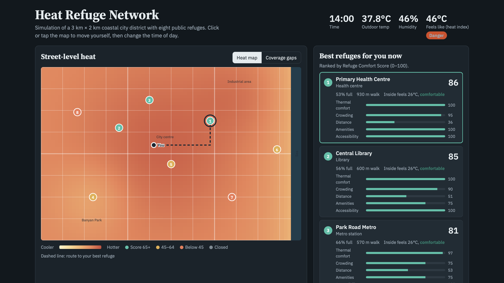
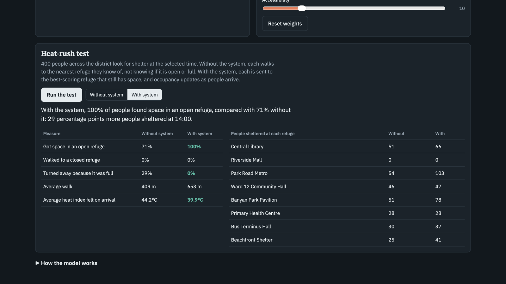
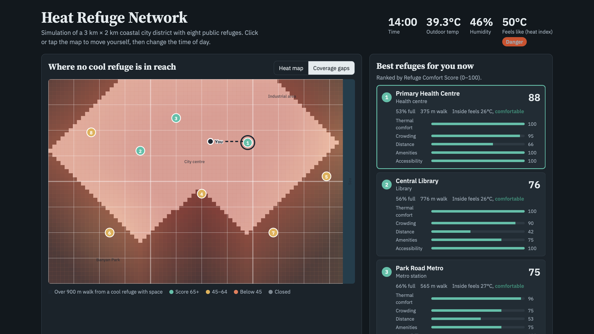

# Heat Refuge Network

A smart-city system that finds the safest, most comfortable nearby public space to escape extreme heat, in real time.

**[Live demo](https://nysas.github.io/Heat-refuge-network/)**

During a heatwave, cities already have cool public spaces: libraries, malls, metro stations, community halls. But people have no live way to know which one is open, actually cool and not already full. Heat Refuge Network scores every refuge on live conditions and sends each person to the best one that still has space.

## Features

- **Live refuge ranking**: every open refuge gets a Refuge Comfort Score (0–100), with an explainable breakdown of its five sub-scores
- **Street-level heat map**: refuges coloured by score, with a walking route to your best option
- **Location-aware**: click or tap the map to move yourself and the ranking updates instantly
- **Scenario controls**: time of day, a "Play the day" animation, heatwave intensity and user profile (general public, or elderly / wheelchair user)
- **Tunable weights**: change how much each factor counts and see the ranking change
- **Heat-rush test**: simulates 400 people seeking shelter at once, with and without the system
- **Coverage-gaps view**: shows planners which areas are more than 900 m from a cool refuge with space

## How the score works

Each open refuge gets five sub-scores between 0 and 1, combined into a weighted score:

S = 100 × Σ(wᵢ · sᵢ) / Σwᵢ

| Component | Default weight | Rule |
|---|---|---|
| Thermal comfort | 35 | Indoor heat index: 1 at 26 °C, falling linearly to 0 at 41 °C |
| Crowding | 25 | 1 up to 50% of capacity, falling as the refuge fills, 0 when full |
| Distance | 20 | e^(−d / d₀) with d₀ = 900 m (500 m for elderly or wheelchair users) |
| Amenities | 10 | Share present of water, seating, toilets and first aid |
| Accessibility | 10 | 1 with step-free access, otherwise 0.6 (0 for wheelchair users) |

For elderly or wheelchair users, a refuge without step-free access also has its total score cut by 60%, which pushes it to the bottom of the ranking. Closed refuges score 0 and drop out.

The heat index is the US National Weather Service Rothfusz regression, computed from temperature and humidity. Walking distance is measured along the street grid.

## Results (simulation)

Seeded simulation of a 3 km × 2 km coastal district with eight refuges (capacities 60–800). Heat-rush test with 400 people at 14:00:

| Measure | Nearest refuge (no system) | Heat Refuge Network |
|---|---|---|
| Found space in an open refuge | 71% | **100%** |
| Turned away because it was full | 29% | **0%** |
| Average heat index on arrival | 44.2 °C | **39.9 °C** |
| Average walk | 409 m | 653 m |

The main finding: in most runs the district had enough space. Information, not capacity, was the bottleneck.

The coverage-gaps view shows where no cool refuge with space is within 900 m, so planners can see where to add refuges or extend opening hours.

## Running it

Open the [live demo](https://nysas.github.io/Heat-refuge-network/), or download the repository and open `index.html` in any modern browser. No installation or server is needed.

## Limitations

- All results come from a synthetic simulation
- The sensing layer (IoT temperature, humidity and occupancy sensors) is designed but not yet deployed
- Distance is measured on a grid and ignores shade and barriers
- Users are assumed to follow recommendations

## Future scope

Pilot deployment in a city ward, real sensor integration, shade-aware routing, multilingual voice and SMS alerts, and integration with IMD heatwave warnings.

## Team

Nysa Sinha, Ishani Mishra, Aman Jhakar
Guide: Swarnalatha P
School of Computer Science, Vellore Institute of Technology, Vellore
